# Hi there, I'm Tahiba! #

Bridging Business, People & Technology

I'm a Management Information Systems graduate from Rochester Institute of Technology (RIT), where I graduated magna cum laude, with a foundation in software engineering and a passion for understanding how technology can solve meaningful business and human challenges.

My interests lie at the intersection of Business Analysis, Product Development, and Technology, where I enjoy translating complex problems into practical, user-centered solutions.

## What I'm Working On ##

**Independent Game Development:** Leading product planning and business analysis for a narrative-driven video game, including requirements documentation, workflow optimization, and user experience considerations.

**Portfolio Development:** Building my personal portfolio using Next.js, React, TypeScript, and Tailwind CSS to showcase projects and case studies.

**Professional Development:** Expanding my knowledge of cloud computing, business process improvement, and software development.

### Technical Skills ###

**Programming & Development:** Python, SQL, HTML, CSS, JavaScript, TypeScript (Learning)

**Data & Analytics:** Excel, Power BI, R, SAS, SQLite, Oracle APEX

**Product & Project Management:** Jira, Agile/Scrum, Requirements Analysis, Process Mapping, Stakeholder Research

**Currently Exploring:** Next.js, React, AWS Cloud Computing

## My Approach ##

I believe effective technology starts with understanding the people and problems behind it.

Whether I'm analyzing barriers to healthcare accessibility, improving development workflows, or designing digital experiences, I enjoy exploring the bigger picture and finding opportunities to make systems more effective and accessible.

## Let's Connect ##

- **Email:** <u>tahiba.rahman.career@gmail.com<u>
- **Linkedln:** <u>https://www.linkedin.com/in/tahiba-rahman/<u>

## Git Statistics ##

